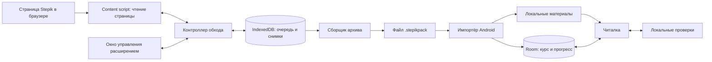

# Системный дизайн OfflineStepik

Статус: проектирование, реализация ещё не начата.

## 1. Сценарий и границы

Личный инструмент: пользователь открывает разрешённый автором курс в своём браузере на ПК, запускает сбор, переносит один файл на телефон и занимается без сети. Собираются теория, изображения, условия и варианты заданий. Видео исключены из первой версии. Поддержка Android 10–17 — целевой диапазон, который предстоит проверить на устройствах.

Расширение использует отображённые страницы и штатные переходы сайта. Собственных запросов к Stepik API нет; сам сайт при работе продолжает делать свои обычные запросы. На телефоне нет сервера, входа в Stepik или обязательного подключения к сети.

Полученное пользователем разрешение распространяется на курсы давшего его автора. Приложение не требует повторного подтверждения при каждом шаге. Данные и результаты остаются локально; передаваемый архив сам по себе не защищает от копирования другим человеком.

## 2. Архитектура



Две независимо устанавливаемые программы связаны только версионированным форматом файла. ПК после импорта курса можно выключить.

## 3. Стек и структура проекта

| Часть | Выбор | Назначение |
|---|---|---|
| Расширение | TypeScript, Manifest V3, HTML/CSS | Chrome/Edge, управление вкладкой и чтение DOM |
| Хранилище ПК | IndexedDB | Материалы, очередь, контрольные точки, бинарные изображения |
| Пакет | JSON с расширением `.stepikpack`, HTML встроен в шаги | Перенос без сервера |
| Android UI | Kotlin, Jetpack Compose | Библиотека, оглавление, задания, настройки |
| Android данные | Room поверх SQLite | Структура, прогресс, ответы, поиск |
| Отображение теории | WebView + WebViewAssetLoader | Локальные HTML, таблицы, код, изображения |
| Импорт Android | Системный выбор документов | Чтение выбранного файла и копирование во внутреннее хранилище |

```text
extension/        # управление, content scripts, обход, экспорт
android/          # APK: импорт, чтение, практика
format/           # JSON Schema, спецификация и примеры пакета
fixtures/         # собственные учебные страницы и маленькие примерные курсы
docs/             # решения и инструкции
```

Python, сервер и отдельная ПК-программа в этой архитектуре не требуются. Расширение устанавливается локально, APK — напрямую на личные устройства. Для обновления APK сохраняется один ключ подписи; пользовательские данные не включаются в репозиторий.

## 4. Расширение и обход курса

### Компоненты

- Окно управления: выбор текущей вкладки, старт, пауза, продолжение, остановка, отчёт и экспорт. Долгую упаковку выполняет открытая страница расширения, а не короткоживущее popup-окно.
- Content script: распознаёт текущий шаг, извлекает учебный блок, варианты ответа и ссылки перехода. Изоляция селекторов в адаптере Stepik позволит исправлять изменения вёрстки в одном месте.
- Контроллер: ведёт очередь и состояние процесса, посылает команды странице, проверяет результат перехода.
- Нормализатор: преобразует страницу в собственную модель, очищает HTML, заменяет ресурсы локальными ссылками.
- Сборщик: создаёт архив из уже сохранённых материалов и отчёт о полноте.

### Последовательность

1. Привязать запуск к одной вкладке и одному курсу. Сохранить начальный URL.
2. Раскрыть оглавление штатным интерфейсом и собрать показанные ссылки. Структуру определять по оглавлению, а не по порядку завершения загрузок.
3. Для каждого шага открыть его ссылку или нажать «Следующий шаг». Переход к следующему уроку выполняется после его последнего шага.
4. Дождаться ожидаемого URL/идентификатора шага, учебного блока и исчезновения индикатора загрузки. Короткая стабилизация DOM служит дополнительным условием, но не заменяет проверку идентичности шага.
5. Прочитать содержимое. Прокрутить учебный блок для загрузки ленивых изображений. Не нажимать «Отправить ответ» и не отмечать задания выполненными.
6. Сохранить шаг и завершение элемента очереди одной транзакцией IndexedDB. Только после этого переходить дальше.
7. Сопоставить оглавление с сохранёнными шагами и показать: сохранено, пропущено, ошибка, недоступно. Неполный курс можно экспортировать с явной отметкой.

Первый прототип должен проверить реальную вёрстку одного курса: доступность полного оглавления, переходы SPA, изображения и формы заданий. Пока курс не исследован, нельзя обещать поддержку всех типов шагов.

### Состояния и восстановление

```text
IDLE → DISCOVERING → RUNNING → COMPLETED
                       ↕
                     PAUSED
                       ↓
                 NEEDS_USER / FAILED
```

Каждый элемент очереди имеет `pending`, `in_progress`, `saved`, `failed` или `unavailable`. После перезапуска незавершённый элемент повторяется; ключ шага предотвращает дубли. Контрольная точка содержит runId, courseId, stepId, URL, состояние, номер попытки и последнее сохранение.

Service worker MV3 может быть остановлен браузером, поэтому глобальная память не является источником истины. Переходы запускаются событиями, состояние читается из IndexedDB. После закрытия браузера продолжение запускает пользователь. При смене курса вручную, выходе из аккаунта или появлении проверки входа сбор приостанавливается.

Начальные параметры: одна страница одновременно, до двух повторов после временной ошибки, тайм-аут шага 30 секунд. Значения настраиваемые. Ограничение сайта приводит к паузе с увеличением интервала.

### Ресурсы и изображения

Сохранять только ресурсы учебного блока. Для изображений сначала использовать обычные доступные URL, на необходимые домены запрашивать узкое разрешение браузера при добавлении курса. Не выдавать расширению доступ ко всем сайтам заранее.

Если изображение нельзя сохранить обычным способом, отметить проблему и предложить снимок видимой области. Скриншот требует активной вкладки; полный шаг собирается прокруткой и несколькими кадрами. Это дополнительный режим, он не даёт интерактивных заданий и ухудшает поиск. Теория по умолчанию хранится как очищенный HTML и текст.

## 5. Контракт .stepikpack v2

Реализация использует один JSON-файл с расширением `.stepikpack`. Формат v2 переносит дерево оглавления из DOM Stepik: разделы, уроки, ссылки и шаги полосы прогресса. У каждого пункта фиксируется, есть ли сохранённое содержимое, чтобы Android мог отключить недоступный офлайн-переход. Приложение сохраняет обратную совместимость с пакетами v1.

Минимальная структура манифеста:

```json
{
  "format": "stepikpack",
  "schemaVersion": 2,
  "packageId": "uuid",
  "courseId": "stepik:123",
  "createdAt": "2026-10-29T12:00:00Z",
  "sourceUrl": "https://stepik.org/course/123",
  "title": "Название курса",
  "author": "Автор",
  "complete": false,
  "files": [
    {"path": "course.json", "size": 100, "sha256": "example-replace-with-actual-hash"}
  ]
}
```

Это иллюстрация полей, не готовый валидный пакет. `steps[].html` содержит очищенный HTML и inline-изображения; `navigation.sections[].lessons[].steps` задаёт кликабельную структуру, `saved` и `savedStepId` связывают пункты оглавления с локальными материалами.

`course.json` содержит упорядоченные модули, уроки и ссылки на шаги. Шаг содержит стабильный ID, URL, тип, заголовок, путь HTML, текст для поиска, варианты со стабильными ID и режим проверки. `contentHash` шага вычисляется из нормализованного содержимого и задания для обнаружения изменений.

Автор и исходные ссылки сохраняются. В архив не попадают cookies, токены, профиль пользователя, меню аккаунта, комментарии других учащихся и браузерная история. Прогресс телефона хранится отдельно от контента курса.

Неизвестная версия схемы отклоняется с понятным сообщением. Совместимость расширения и APK определяется схемой пакета, а не совпадением версий программ.

## 6. Android: импорт и чтение

Импорт выполняется через системный выбор документов. Приложение проверяет формат и версию, разбирает структуру и сохраняет пакет в отдельной внутренней папке `files/courses/<название-и-id>/`. Повторный импорт курса с тем же стабильным ID обновляет его папку; другой курс создаёт отдельную запись библиотеки. При ошибке содержимое библиотеки не меняется.

Пути архива должны оставаться внутри staging: запрещены абсолютные пути, `..`, симлинки и дубли имён. Начальные ограничения для пакетов без видео: 500 МБ распакованных данных, 20 МБ на файл и 20 000 файлов. Размеры контролируются по реально прочитанным данным, а не только по ZIP-заголовкам. Перед импортом проверяется свободное место.

Теория отображается в WebView с локальным CSS, таблицами и подсветкой кода. WebViewAssetLoader отдаёт файлы из внутреннего хранилища через локально перехватываемые URL, не поднимая HTTP-сервер. Внешние запросы блокируются; ссылки на источник открываются только по нажатию во внешнем браузере.

Скрипты курса и обработчики событий удаляются, JavaScript в первом варианте отключён. Формулы сохраняются как MathML или статическая разметка/изображение; точность отображения проверяется на примере курса. Если понадобится собственный движок формул, это отдельное решение с локально поставляемыми ресурсами.

Главные экраны реализации: библиотека курсов → оглавление с разделами/уроками/полосой шагов → шаг. Несобранные пункты показываются отключёнными. Открытие приложения и повторный вход в курс после перезапуска работают без сети; APK не требует разрешения INTERNET.

## 7. Данные и обновления

| Сущность | Основные поля |
|---|---|
| Course | courseId, title, author, activeRevisionId |
| Revision | revisionId, packageId, courseId, importedAt, manifestHash |
| Module / Lesson | id, revisionId, parentId, position, title |
| Step | stepId, revisionId, lessonId, position, type, htmlPath, contentHash |
| Progress | courseId, stepId, lastRevisionId, readStatus, scrollPosition |
| Attempt | id, stepId, contentHash, answerJson, checkerVersion, verdict, timestamp |
| Note | id, courseId, stepId, text, updatedAt |

Повторный импорт того же пакета ничего не дублирует. Обновление курса сохраняет заметки и прогресс по стабильным ID. При изменении `contentHash` старый результат проверки остаётся в истории с пометкой «предыдущая версия». Удалённый из курса шаг не уничтожает его заметки автоматически. Для переноса собственных ответов между телефонами позже можно добавить отдельный файл резервной копии прогресса.

## 8. Проверки

Три режима на каждом задании:

| Режим | Поведение |
|---|---|
| local | Детерминированная локальная проверка по включённым правилам |
| self | Пользователь сверяет ответ и отмечает результат сам |
| online_required | Сохранение черновика и ссылка на оригинальное задание |

Для первой версии поддержать декларативные правила: выбор одного/нескольких вариантов, точное текстовое совпадение с явно указанными преобразованиями, числовой ответ с указанным допуском. Правило содержит происхождение: предоставлено автором либо явно показано на странице, и версию.

Наличие вариантов ответа не означает наличие правильного ответа. Генерировать ключи предположениями нельзя. Снимок страницы и извлечённый HTML не переносят серверный грейдер. Задачи на программирование в первой версии сохраняют условие и черновик кода; выполнение произвольного кода из пакета не поддерживается. История прежнего вердикта не считается универсальным правилом проверки.

## 9. Ошибки и наблюдаемость

| Событие | Реакция |
|---|---|
| Вёрстка не распознана | Остановить текущий шаг, показать URL и причину; не сохранять пустую страницу как успех |
| Сессия истекла | Пауза до обычного входа пользователя |
| Следующая ссылка ведёт в другой курс | Пауза, не выходить за границы выбранного курса |
| Недоступное изображение | Явный placeholder и запись в отчёте |
| Закрылась вкладка / браузер | Сохранённая очередь позволяет продолжить |
| Закончилось место | Остановить запись; сохранить предыдущую завершённую версию |
| Повреждённый пакет | Отменить импорт, сохранить существующий курс |

Локальный журнал содержит время, ID шага, состояние, код ошибки и версию адаптера. Текст курса, cookies и ответы не включаются в диагностический журнал. Для диагностики пользователь отдельно выбирает нужные файлы.

## 10. Реализация и критерии приёмки

1. Сначала зафиксировать схему пакета и сделать вручную пример из нескольких собственных шагов: теория с картинкой, выбор ответа, задача без проверки.
2. Реализовать Android-импорт и чтение этого примера в авиарежиме. Это проверяет конечную цель до разработки большого обходчика.
3. Сделать извлечение одного реального шага через DOM, затем переходы внутри урока, затем обход оглавления.
4. Добавить восстановление после закрытия браузера, отчёт полноты и экспорт.
5. Подключить локальные правила, историю ответов и обновление курса без потери заметок.

Необходимые проверки при реализации: переходы SPA без дублирования шагов; перезапуск между сохранением и навигацией; импорт расширением созданного пакета; повреждённый ZIP и выход за каталог; сохранность прогресса после обновления; отсутствие сетевых зависимостей; установка и работа на Android 10 и 17. Для промежуточной версии Android полезен отдельный эмулятор. До этих проверок совместимость считается целью, а не подтверждённым результатом.

Цель первой версии: разрешённый курс читается на обоих телефонах после передачи одного файла; все пропуски видны; программа не сообщает об успешной проверке, если локального правила нет. Объём и скорость оцениваются после исследования одного настоящего курса.

## Источники технических решений

- [Жизненный цикл service worker расширения](https://developer.chrome.com/docs/extensions/develop/concepts/service-workers/lifecycle) — необходимость постоянного хранения состояния.
- [Локальное содержимое Android WebView](https://developer.android.com/develop/ui/views/layout/webapps/load-local-content) — отображение без HTTP-сервера.
- [Системный выбор документов Android](https://developer.android.com/training/data-storage/shared/documents-files) — импорт файла.
- [Room](https://developer.android.com/training/data-storage/room) — локальная база.
